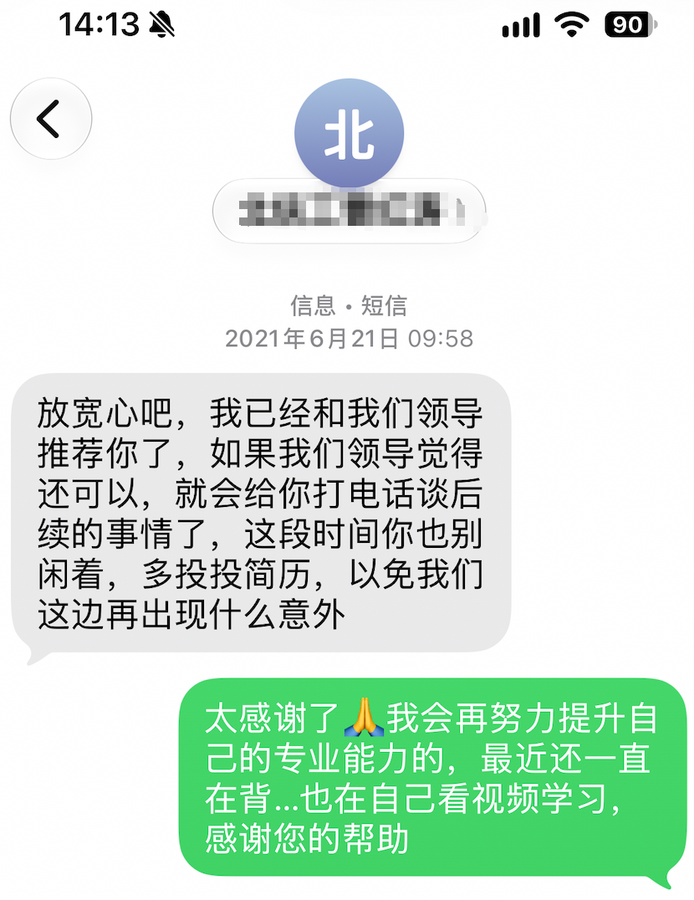

## 终于还是走到这一步了
本来就是想记下今天的流水账，但是想想，写写五年的流水账吧

> 2021年毕业在家一周，决定求职

```
面试
云吾广告
同方药业
青岛润和互动6.21下午两点
鹿饮溪信息技术
方天科技6.22上午九点半
海利尔药业集团
环球集团web
会心一笑
金蝶聚星
德耐尔
```

这是一部分的公司吧，什么行业的都有，当时也是没什么信心能找到本专业的工作。来现在的公司也是误打误撞，没在计划里，面试一个问题都没答上来，面试官给了二次机会，那条短信我还留着。


再后来就是在一个地下车库收到了hr的电话，当时说5500能不能接受，我开心的不行，其实比我预想的要低，但是也是我向往的公司，自然就放低了身价，忽视了待遇。

进来之后先是震惊这个小办公室，后来才知道这只是办事处，去北京办理入职并进行新员工培训的时候才见到本部大楼，在北京这个寸土寸金的地界，我认为还是挺气派的。

在北京呆了两周，去了很多没去过的地方，鸟巢、颐和园、圆明园、长城、中关村。。。也吃了很多特色小吃，炒肝、老北京炸酱面、豆汁。。。

刚工作，我前所未有的努力，因为我觉得，在学校学不好是挨训，到了社会干不好是饿死，我每天学到凌晨，最终也是不枉费努力，能独当一面。

直到23年，疫情结束后的行情大跌，每年的普涨也取消了，项目也不如之前有挑战性，我开始动摇了，那时的我一身本领，很快便找到了下家，提离职那天我哭了，很不舍得领导的栽培和照顾。不过最终，我没走成，面试的公司还是不太如意，经验不足，于是又在这里干了3年，开始了银行驻场的生涯。

刚来的时候是从大连出差回来，也是非常努力的在学习新业务，再后来，更多的是运维工作和编程工作混合，我又开始动摇，这与我的职业规划严重不符，甚至开始后悔23年没走，当时应该多出去看看，闯荡一下，越年纪大越没机会了。

最终我还是离开了，ai的发展让我看到了机会，我开始主导ai项目的工作，积攒经验，经过半年多的努力，提交了离职申请。

回看这五年，并不后悔什么，每一步都算数，也能看见自己在进步，不管是技术还是工作能力，也确实很谢谢这一路上支持我的人，帮助栽培我的人，祝好。

* 流水账来了，早晨骑车都是绿灯，没迟到打卡，在店里吃了早餐，居然在最后一次光顾的时刻，在包子里第一次吃到了塑料纸，然后就是忙碌的上午，真得上站好最后一班岗了。中午在选择吃猪肘饭还是糁汤还是面的时候犹豫了，最终决定吃面，确实好吃，现在已经是下午三点了，晚上本来喊老婆吃寿司郎，她扬言说减肥不去，那我也不去健身了今天，休息休息，明天后天休息两天，算是给自己放个小假，下周上班了！！！
